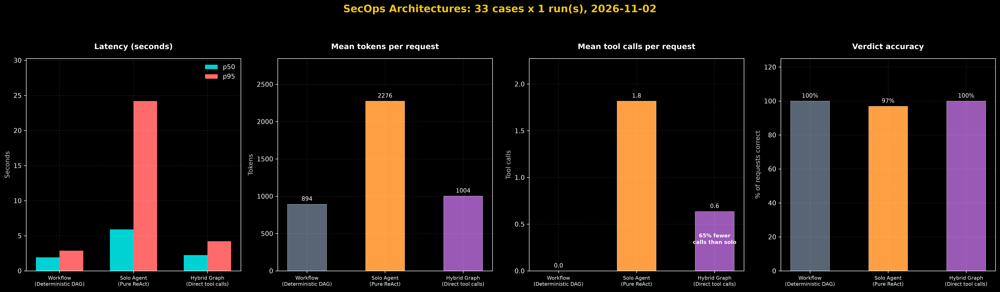

# secops-recovery-agent: workflow vs agent vs hybrid



An assistant that triages requests to restore a backup. It reads the request, decides with plain code whether an instant restore is allowed, pauses for a human to approve eligible ones, and writes the reply. It does not perform the restore itself. The same job is built three ways (a fixed workflow, a free-roaming agent, and a hybrid) and measured on 33 test requests.

- **Triage:** reads free text such as "restore our audit_log from 1 September 2026" and works out the resource and the date.
- **Decision by code:** compares the age of the snapshot with the rules in one config file. The AI never decides.
- **Human in the loop:** an eligible restore waits for a person to approve or decline. Every decision, approval and escalation is written to an audit file.
- **Benchmark:** 33 requests generated from the rules, run through all three designs, with speed, tokens, tool calls and accuracy saved to JSON and charted.

## Contents

1. [How it works](#how-it-works)
2. [The three architectures](#the-three-architectures)
3. [Examples](#examples)
4. [Results](#results)
5. [Safety features](#safety-features)
6. [Setup and running](#setup-and-running)
7. [Configuration](#configuration)
8. [Project layout](#project-layout)
9. [Known limits](#known-limits)

## How it works

```
 request text
      │
      ▼
 ┌───────────┐   fails 3 times   ┌────────────┐
 │ 1. EXTRACT│ ────────────────> │  ESCALATE  │ ──> alert file
 │   (AI)    │                   │   (code)   │
 └─────┬─────┘                   └────────────┘
       │ resource + date
       ▼
 ┌───────────┐
 │ 2. DECIDE │   rules come from config/policy.json
 │  (code)   │
 └─────┬─────┘
       ├── ELIGIBLE ───────> HUMAN APPROVAL ────┐
       ├── NOT_ELIGIBLE ───> RESOLVE (hybrid) ──┤
       └── anything else ───────────────────────┤
                                                ▼
                                         ┌────────────┐
                                         │  3. REPLY  │  if the AI fails:
                                         │    (AI)    │  plain policy text
                                         └────────────┘
```

Four rules run through the whole project:

1. **The AI never makes the eligibility decision.** It extracts facts (resource, date) and writes wording. `decide()` is plain code.
2. **The rules live in one file**, `config/policy.json`. The tools, the tests, the prompts and the knowledge text all read it, so they cannot disagree.
3. **Every AI step has a fallback.** Extraction that fails three times escalates. A reply that fails falls back to the plain policy text.
4. **Nothing claims more than happened.** The escalation reply says an alert was recorded only if the write succeeded.

### The rules

| Resource | Hot restore window | Cold (Glacier) copy | Fallback when denied |
|----------|--------------------|---------------------|----------------------|
| `db_snapshot` | 14 days | none | replay from read-replica WAL logs or a warehouse delta export |
| `audit_log` | 30 days | 365 days | deep-archive retrieval while in the vault, otherwise a partial SIEM summary |
| `sandbox_env` | 7 days | none | Terraform re-seed from the golden image |
| `ephemeral_cache` | never restorable | none | none |

### The verdicts

| Verdict | Meaning |
|---------|---------|
| `ELIGIBLE` | within the hot window; waits for human approval |
| `NOT_ELIGIBLE` | too old, or the resource can never be restored |
| `NEEDS_MORE_INFO` | resource or date missing, unknown resource, or a date in the future |
| `NO_RESTORE_REQUESTED` | a general question, not a restore request |
| `APPROVAL_DENIED` | a person declined the restore |
| `ESCALATE_TO_SECOPS` | extraction failed, so the request goes to the on-call alert file |

## The three architectures

| Design | Files | Who chooses the steps | When a restore is denied |
|--------|-------|-----------------------|--------------------------|
| Workflow | `recovery_workflow.py`, `workflow_nodes.py` | code, in a fixed order | states the decision only |
| Solo agent | `solo_agent.py` | the AI, tool by tool | the AI looks up options itself |
| Hybrid | `hybrid_graph.py` | code, in a fixed order | calls `list_dr_alternatives` directly, and `check_glacier_vault` when the resource has a vault tier |

A fourth file group, `plan_and_execute.py` with `plan_nodes.py` and `plan_state.py`, is a separate experiment: a planner, an executor and a re-planner answer a question using a knowledge text built from the policy file. It is not part of the benchmark.

## Examples

All examples used a pinned date of 2026-10-29, set in `.env`:

```
RECOVERY_REFERENCE_DATE=2026-10-29
```

Pinning makes the ages repeatable. Leave it unset for real use. The **Decision** line comes from plain code, so for the same extracted facts it is always the same. The facts come from the AI, and the **Reply** is written by the AI, so wording changes from run to run.

Examples 1 and 2 are copied from the demo scripts. Examples 3 to 7 come from `python try_examples.py`, which runs requests through the workflow and prints what the AI extracted, the code's decision and the reply.

### 1. An eligible restore, with human approval

Output of `python -m src.recovery_workflow` (timings removed):

```
Request : We need to restore a sandbox_env from 25 October 2026 after a bad deploy.
Approve this restore? [y/N] y
Trace   : extract_ok -> resource=sandbox_env, date=2026-10-25
          decide -> ELIGIBLE (Target date is 4 days old (within the 7-day hot-tier window for sandbox_env).)
          approval -> approved by local-demo
          draft
Verdict : ELIGIBLE
Reply   : Your request is **ELIGIBLE**. The target date (25 Oct 2026) is only 4 days old, within the
          7-day hot-tier window for sandbox_env. We will proceed with the restoration.
```

The graph stops at the approval step and waits for a person. If the answer is `n`, the verdict becomes `APPROVAL_DENIED` with the reason "The restore was not approved by local-demo." The system records the approval; it does not run a restore.

### 2. A denied restore, with fallback options (hybrid)

Output of `python -m src.hybrid_graph` (timings removed):

```
Request : Our compliance team needs an audit_log restore from 01 September 2026.
Trace   : extract_ok -> resource=audit_log, date=2026-09-01
          decide -> NOT_ELIGIBLE (Target date is 58 days old, exceeding the 30-day hot-tier window for audit_log.)
          resolve -> tools=['list_dr_alternatives', 'check_glacier_vault']
          draft_h -> complete
Tools   : 2 ['list_dr_alternatives', 'check_glacier_vault']
Reply   : Sorry, NOT_ELIGIBLE. The requested audit_log from 01 Sep 2026 is 58 days old, beyond the
          30-day hot-tier window. You can retrieve it for free from the Glacier vault (307 days of
          cold retention remain) or get a partial SIEM index summary. No other options available.
```

`audit_log` has a Glacier tier (365 days), so the vault check runs. A denied `db_snapshot` request calls only `list_dr_alternatives`, because it has no cold copy. The sentence "No other options available" is the model's own addition.

### 3. A resource that can never be restored

```
Request   : Can you restore our ephemeral_cache from 20 October 2026?
Extracted : ephemeral_cache, 2026-10-20
Decision  : NOT_ELIGIBLE (ephemeral_cache is volatile and has no backup tier, so it cannot be restored.)
Reply     : I’m sorry, but we cannot restore your ephemeral_cache from 20 October 2026. The cache is
            volatile and has no backup tier, so restoration is not possible.

Request   : We lost our ephemeral_cache, please restore it.
Extracted : ephemeral_cache, None
Decision  : NOT_ELIGIBLE (ephemeral_cache is volatile and has no backup tier, so it cannot be restored.)
Reply     : I’m sorry, but we cannot restore the lost data. The **ephemeral_cache** is volatile and has
            no backup tier, so it cannot be recovered. If you have any other questions or need
            assistance with other data, let us know.
```

No date is needed: the second request has none and gets the same decision.

### 4. Missing or unusable information

```
Request   : I need an emergency restore for the production cluster we lost.
Extracted : unknown, None
Decision  : NEEDS_MORE_INFO (Missing required triage parameters: resource type, target snapshot date (YYYY-MM-DD).)
Reply     : I’m ready to help with the emergency restore. To proceed, could you please provide:
            1. The **resource type** (e.g., database, VM, storage bucket).
            2. The **target snapshot date** in **YYYY-MM-DD** format.
            Thanks!

Request   : Please restore our Kafka topics from 27 October 2026.
Extracted : unknown, 2026-10-27
Decision  : NEEDS_MORE_INFO (Missing required triage parameters: resource type.)
Reply     : NEEDS_MORE_INFO: Please specify the resource type (e.g., topic name, cluster ID) for the
            Kafka restore request.

Request   : Restore audit_log from 1 November 2026.
Extracted : audit_log, 2026-11-01
Decision  : NEEDS_MORE_INFO (Requested snapshot date 2026-11-01 is in the future relative to 2026-10-29.)
Reply     : NEEDS_MORE_INFO: Please provide a past date for the audit_log restore (e.g., 2026-10-15).
```

A resource that is not in the rules file (Kafka) is extracted as `unknown`, so it is treated as missing information.

### 5. A question, not a restore

```
Request   : What is our hot retention policy for audit logs?
Extracted : unknown, None
Decision  : NO_RESTORE_REQUESTED (Engineer asked a general question and did not request a snapshot restore.)
Reply     : I’m sorry, but I can’t share that information.
```

The verdict is right, but the reply is not helpful: the writer is told the decision is final and not to invent policy, so it declines to explain the policy at all (see Known limits).

### 6. Dates in different formats

```
Request   : Restore audit_log from 1 September 2026.
Extracted : audit_log, 2026-09-01
Decision  : NOT_ELIGIBLE (Target date is 58 days old, exceeding the 30-day hot-tier window for audit_log.)

Request   : Restore audit_log from September 1, 2026.
Extracted : audit_log, 2026-09-01
Decision  : NOT_ELIGIBLE (Target date is 58 days old, exceeding the 30-day hot-tier window for audit_log.)

Request   : Restore audit_log from sometime last week.
Extracted : audit_log, None
Decision  : NEEDS_MORE_INFO (Missing required triage parameters: target snapshot date (YYYY-MM-DD).)
Reply     : NEEDS_MORE_INFO: Please provide the target snapshot date (YYYY-MM-DD) for the audit_log restore.
```

Common formats are turned into `YYYY-MM-DD`. A vague date is not guessed: the model returns no date, and the system asks for one. If extraction fails three times in a row (for example the model keeps returning a date the system cannot read), the request is escalated and an alert is written to `alerts.jsonl`. A test covers this path.

### 7. Changing a rule

In `config/policy.json`, change `sandbox_env` from `"hot_days": 7` to `"hot_days": 3` and run the request from example 1 again:

```
Request   : We need to restore a sandbox_env from 25 October 2026 after a bad deploy.
Extracted : sandbox_env, 2026-10-25
Decision  : NOT_ELIGIBLE (Target date is 4 days old, exceeding the 3-day hot-tier window for sandbox_env.)
Reply     : I’m sorry, but this request is **NOT_ELIGIBLE**. The target date (25 Oct 2026) is 4 days old,
            which exceeds the 3-day hot-tier window for restoring a sandbox_env. No restoration can
            be performed.
```

No code changes were needed. Change it back afterwards.

### 8. Using it from Python

```python
from langgraph.types import Command
from src.recovery_workflow import app

cfg = {"configurable": {"thread_id": "ticket-123"}}           # a thread id is required
app.invoke({"message": "Restore sandbox_env from 25 October 2026."}, config=cfg)

app.get_state(cfg).next                                       # ('approval',): waiting for a human
app.invoke(Command(resume={"approved": True, "approver": "alice"}), config=cfg)

result = app.get_state(cfg).values
print(result["decision"].verdict, "|", result["reply"])
```

The thread id is how a paused request is found again. Every decision and approval is also written to `audit.jsonl`.

## Results

One run of 33 requests per design. The expected answer for each request comes from the rules file, not from the AI.

| | Workflow | Solo agent | Hybrid |
|---|---|---|---|
| Correct verdicts | 33/33 | 32/33 | 33/33 |
| Median time | 1.9s | 5.9s | 2.3s |
| Slowest 5% | 2.9s | 24.2s | 4.2s |
| Mean tokens | 894 | 2276 | 1004 |
| Tool calls per request | 0.0 | 1.8 | 0.6 |
| Fallback options given | 0/14 (by design) | 14/14 | 14/14 |

What this shows:

- **For fixed rules, fixed steps win.** The workflow and the hybrid are fast, cheap and accurate. The solo agent is slower, uses more than twice the tokens, and has the worst slow case.
- **The hybrid adds the recovery options for about 100 more tokens** than the workflow, because it does direct lookups instead of running an agent. In an earlier 5-request benchmark, a version that ran a 70B sub-agent for the same lookups had a median of 9.0s and used 1813 tokens, against 2.3s and 1004 now.
- **The solo agent is not repeatable.** Over five runs it missed different requests each time, while the workflow and the hybrid were near-perfect. Tuning its prompt moved the misses around and did not remove them.

## Safety features

| Feature | What it does | File |
|---------|--------------|------|
| Human approval | an `ELIGIBLE` restore pauses until a person approves or declines | `approval.py` |
| Audit log | one JSON line per decision, approval and escalation, with time and thread id | `audit.py` |
| Honest alerts | writes the alert to a file, optionally also to a webhook, and reports whether it really arrived | `notify.py` |
| Single rules file | every rule loaded and validated from one place; a bad value stops the start with a clear message | `policy.py` |
| Safe start-up | no model is created at import; timeouts and limited retries on every model | `llm.py` |
| Date reading | common formats such as "1 September 2026" become `YYYY-MM-DD`; anything unreadable is rejected | `dates.py` |

## Setup and running

You need Python 3.11 or newer (developed on 3.12) and a Groq API key.

```
python -m venv .venv
.venv\Scripts\activate          # Mac/Linux: source .venv/bin/activate
pip install -r requirements.txt
copy .env.example .env          # Mac/Linux: cp .env.example .env
```

Open `.env` and set `GROQ_API_KEY`. Never commit `.env`; it is in `.gitignore`.

| Command | What it does |
|---------|--------------|
| `python -m pytest -q` | runs the 35 tests; they use a fake model, so no key or network is needed |
| `python -m src.recovery_workflow` | demo of the workflow; pauses and asks `Approve this restore? [y/N]` |
| `python -m src.hybrid_graph` | demo of the hybrid on a denied `audit_log` restore |
| `python -m src.solo_agent` | demo of the solo agent |
| `python -m src.plan_and_execute` | demo of the plan-and-execute experiment |
| `python try_examples.py "your request"` | runs your request through the workflow and prints the extracted facts, the decision and the reply; with no argument it runs 9 built-in requests. An eligible request stops at approval and shows "(waiting for approval)" |
| `python -m tests.capstone_benchmark --runs 1` | runs all three designs on 33 requests and saves `results/benchmark.json` |
| `python charts.py` | draws `secops_performance_infographic.png` from that file |

Benchmark flags: `--limit 6` for a quick sample, `--systems workflow,hybrid` to run only some designs, `--runs 3` to repeat each request. Each run overwrites `results/benchmark.json`. The benchmark switches approval to automatic for its own process only, because nobody is there to click.

## Configuration

Change a rule by editing `config/policy.json`; no code changes.

```json
"audit_log": {
  "hot_days": 30,
  "restorable": true,
  "glacier_days": 365,
  "aliases": ["SIEM logs", "security logs", "access logs"],
  "dr_alternative": "Free deep-archive retrieval while inside Glacier vault retention; otherwise partial SIEM index summary."
}
```

Changing a value takes effect on the next start. Adding a new resource name also works from this file, but needs a restart because the list of names is read once at start-up. The benchmark requests and the tests are generated from this file too.

Main settings in `.env` (see `.env.example` for all of them):

| Name | What it does |
|------|--------------|
| `GROQ_API_KEY` | the only required secret |
| `MODEL_LARGE`, `MODEL_FAST` | Groq models for extraction and for replies (defaults `llama-3.3-70b-versatile` and `llama-3.1-8b-instant`) |
| `LLM_TIMEOUT_S`, `LLM_MAX_RETRIES` | timeout and retries for every model call |
| `SECOPS_POLICY_PATH` | use another rules file |
| `RECOVERY_REFERENCE_DATE` | fixes "today" for repeatable demos; leave it unset for real use |
| `ALERT_FILE`, `AUDIT_FILE` | where alerts and the audit log are written |
| `ALERT_WEBHOOK_URL` | optional Slack or Teams style webhook for alerts |
| `AUTO_APPROVE` | skips human approval; for the benchmark only, never set it for normal use |

Files the system writes while running (all git-ignored): `audit.jsonl` and `alerts.jsonl`. They keep up to 200 characters of each request text.

## Project layout

```
config/           policy.json, the single source of truth for the rules
src/              policy, llm, dates, recovery_core (data shapes and decide()),
                  dr_tools, notify, audit, approval, workflow_nodes,
                  recovery_workflow, solo_agent, hybrid_graph,
                  plan_state, plan_nodes, plan_and_execute
tests/            35 tests, conftest.py, cases.py (benchmark requests),
                  capstone_benchmark.py
results/          benchmark.json, written by the benchmark
charts.py         draws the infographic from results/benchmark.json
try_examples.py   try your own requests against the workflow
pytest.ini        tells pytest where the code is
```

## Known limits

This is built to production-style standards but has not been run for real users. Still missing or weak:

- **No restore is executed.** The system decides, records the approval and replies. The AI's reply can still sound as if it will act ("We will proceed with the restoration").
- **General questions get an unhelpful reply.** "What is our hot retention policy?" gets the right verdict but a reply that declines to explain the policy. Answering such questions from the rules file is not built.
- **Approver identity.** The approver is a name the caller passes in; there is no login or permission check.
- **Durable pauses.** A request waiting for approval is held in memory and is lost when the program restarts. A durable saver would fix this.
- **A real pager.** Alerts go to a local file. The webhook option has not been tested against a real service.
- **Audit log hardening.** It is not tamper-evident, and its lock protects only against threads in one process.
- **No automated checks on commit** and no tracing switched on.
- **Reply wording is not verified.** The decision is final, but nothing checks that the written reply matches it; a plain-text fallback is used only when the AI call fails.
- **Small benchmark.** One run of 33 requests shows direction, not proof. The solo agent's verdict is inferred from its tool calls.
- **Dates:** only common formats are understood; a vague date is treated as missing.

## Built with

LangGraph and LangChain, Groq models, Pydantic, pytest, NumPy and Matplotlib.